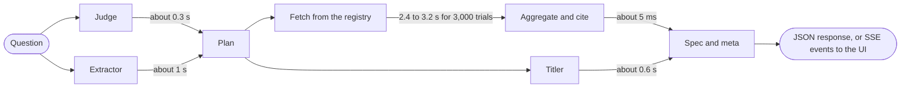
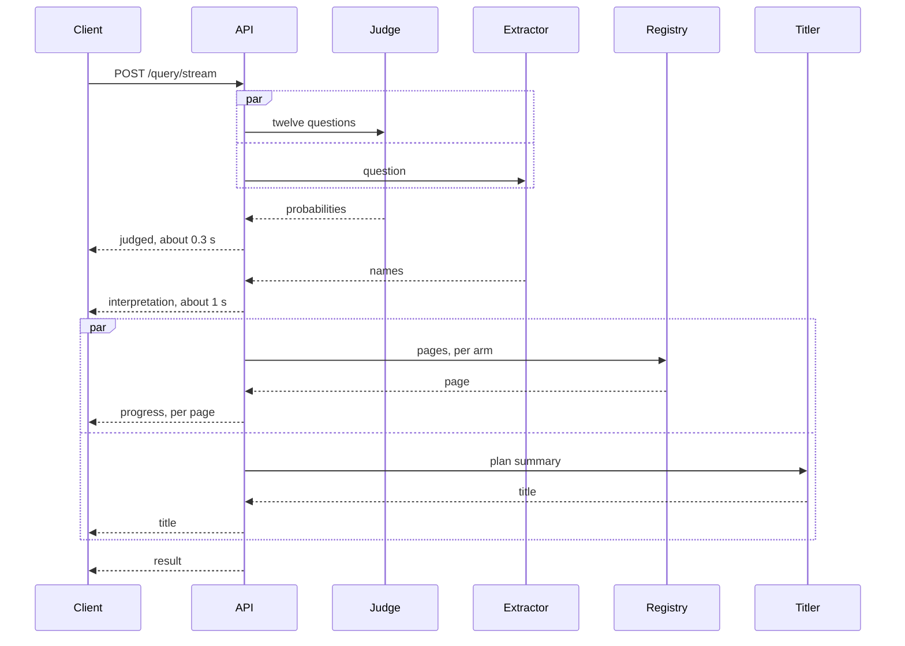
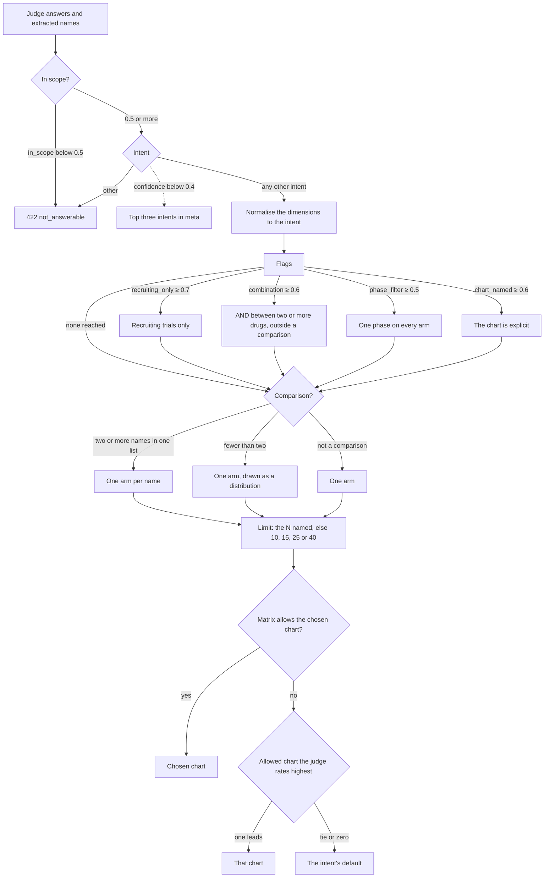
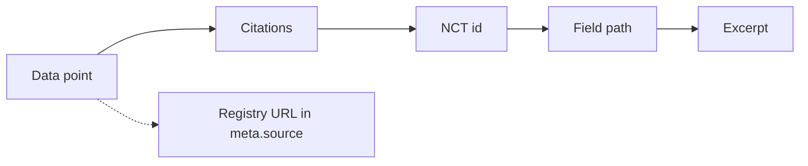

# ChatCTG

ChatCTG (short for ChatClinicalTrials.gov) answers a question about clinical trials with a chart spec built from live registry data. `POST /query` with "How are melanoma trials distributed across phases?" returns a typed spec (chart type, encoding, rows) and metadata that explains each decision and cites the records behind each number. A small React app renders it.

The judge, a System One model (TypeSafe's Jev in this build), answers every closed decision as a probability over fixed options. The extractor, an LLM under a strict JSON schema (`gpt-5.4-nano` in this build), copies the names the question mentions, and the titler, the same LLM, titles the finished plan. The rest is code: plan the requests to the registry (ClinicalTrials.gov v2), fetch, aggregate, cite, and validate against a zod contract. No number comes from a model.

The diagram gives each stage's typical time in the nine example runs, which took 1.5 to 5.0 s end to end. The detailed drawing is [docs/architecture.excalidraw](docs/architecture.excalidraw), which opens at [excalidraw.com](https://excalidraw.com).



## Run it

Node 22.9 or later (`.nvmrc` pins 24), npm, a TypeSafe key for the judge and an OpenAI key for the extractor and the titler.

```bash
cp .env.example .env         # then set TYPESAFE_API_KEY and OPENAI_API_KEY
npm install
npm run dev                  # API on :3001 and web on :5173 (Vite proxies the API)
npm run build && npm start   # one process on :3001 serves the API and the built web app
npm run check                # typecheck, lint and the offline tests
npm run eval:jev             # the judge evaluation; rewrites eval/report.md, so restore its hand-written sections
npm run eval:extract         # the extractor benchmark
npm run examples             # the nine live example runs into examples/
npm run fixtures:record      # re-records the registry fixture pages
```

| Variable | Default | Used for |
|---|---|---|
| `TYPESAFE_API_KEY`, `OPENAI_API_KEY` | none; `/query` answers 502 without them | the judge; the extractor and the titler |
| `TYPESAFE_MODEL` | `jev-latest` | the judge's model id |
| `EXTRACTOR_MODEL`, `TITLER_MODEL` | `gpt-5.4-nano` | the LLM's model ids |
| `TYPESAFE_BASE_URL`, `OPENAI_BASE_URL` | the vendors' public URLs | proxies |
| `PORT` | `3001` | the API port |

Docker: `docker build -t chatctg . && docker run --rm -p 3001:3001 --env-file .env chatctg`.

### Deploy

`fly.toml` runs one `shared-cpu-1x` machine with 512 MB in `gru` (São Paulo), health-checked on `/health`. A deployed instance answers at https://chatctg.fly.dev. To deploy your own, set `app` in `fly.toml` to a name of yours, then:

```bash
fly auth login
fly launch --copy-config --no-deploy
fly secrets set TYPESAFE_API_KEY=… OPENAI_API_KEY=…
fly deploy
```

## API

| Route | Purpose |
|---|---|
| `POST /query` | question in; chart spec and metadata out |
| `POST /query/stream` | the same body, answered with Server-Sent Events |
| `GET /schema` | the JSON Schema of the request and the response, generated from the zod contract |
| `GET /health` | liveness and the registry's data version |

### Request

JSON, at most 64 KB. An unknown field gets a 400, so a typo never widens a query. A field the caller sets replaces what the extractor or the judge would decide, and is listed in `meta.interpretation.provided_fields`.

| Field | Type | Validation and effect |
|---|---|---|
| `query` | string, required | 1 to 500 characters |
| `drug_name`, `condition`, `sponsor`, `country` | string or string[] | at most 10, each 1 to 200 characters; replace the extracted names |
| `trial_phase` | `EARLY_PHASE1` to `PHASE4`, or `NA` | becomes `AREA[Phase]` in `filter.advanced` |
| `trial_status` | the registry's overall status | becomes `filter.overallStatus` |
| `start_year`, `end_year` | integer | 1900 to 2100, the end not before the start |
| `intent` | one of nine | skips the scope check; a "did you mean" chip sends it |
| `chart` | one of fourteen | an explicit ask, still checked against the chart matrix |
| `max_studies` | integer | 100 to 10,000, default 3,000; the most studies read per arm |
| `citations_per_point` | integer | 0 to 25, default 5; 0 turns citations off |

```bash
curl -s localhost:3001/query -H 'content-type: application/json' \
  -d '{ "query": "How has the number of trials for this drug changed per year since 2015?", "drug_name": "Pembrolizumab" }'
```

### Response

The body is `{ visualization, meta }`. `visualization` is a union on `type`, each member with `title`, `subtitle`, `encoding` and `data`. Every row, edge and link also carries `study_count` and `citations`, left out below. A value cell is named after the metric (`trial_count`, `enrollment_total`, `enrollment_median`), a category cell holds the label and `<field>_key` the registry's key, and time rows use `period` (`2019`, `2019-Q2`, `2019-05`). `GET /schema` has the full schema.

<details>
<summary>Every chart type, with its encoding and one row of data</summary>

| `type` | `encoding` | `data` |
|---|---|---|
| `bar` | `x` (dimension or `period`), `y` (metric), `orientation`, `sort` | `{ <x>, <x>_key, <metric>, iso3? }` |
| `grouped_bar`, `stacked_bar` | as `bar`, plus `series` | as `bar`, plus `series`, zero-filled; an open second grouping keeps its top 8 |
| `line` | `x` (`period`, `granularity`), `y`, `series?` | `{ period, series?, <metric> }`, gap-filled |
| `histogram` | `x` with `bins`, `y` | `{ <x>: bin, <x>_key, <metric> }`; enrollment bins `1-50` to `1001+` |
| `scatter` | `x` start date, `y` enrollment, `color?`, `series?`, `point_id` | one per trial, at most 500: `{ nct_id, title, start_date, enrollment, phase, series? }` |
| `network_graph` | `nodes`, `edges`, `layout` | `{ nodes: [{ id, label, kind, size }], edges: [{ source, target, weight }] }`; the `limit` heaviest edges |
| `map` | `geo` (`country`, `iso3`), `value` | `{ country, iso3, <metric> }`; `iso3` is ISO 3166 alpha-3, or null |
| `table` | `columns`, `sort` | one per trial: `{ nct_id, title, status, phases, start_date, sponsor, conditions, enrollment }` |
| `single_value` | `value` | `{ value, label }`; `value` is the registry's exact `totalCount` |
| `bubble`, `heatmap` | `x`, `y` (second grouping, or the arms), `size` or `color` (metric) | one per cell, empty cells included: `{ x, x_key, y, y_key, <metric> }` |
| `timeline` | `start`, `end` (primary completion), `label`, `color` (phase), `point_id` | one per trial, at most 60: `{ nct_id, title, start_date, end_date, phase, status }`; `phase` is the highest, so a Phase 2/3 trial reads "Phase 3" |
| `sankey` | `nodes`, `links`, `left`, `right` | `{ nodes: [{ id, label, side }], links: [{ source, target, value }] }`; one link per non-empty pair |

</details>

<details>
<summary>Every <code>meta</code> field</summary>

| `meta` field | Meaning |
|---|---|
| `request` | the validated request as received, with defaults applied |
| `extraction` | the extractor's reading of the question, before request fields override it: `{ drugs, conditions, sponsors, countries, start_year, end_year, limit }` |
| `interpretation` | every decision, with the judge's probability where it has one: `intent` (with `alternatives` when the confidence is below 0.4), `dimension`, `secondary_dimension`, `chart` (`chosen`, `applied`, `explicit`, `reason`), `metric`, `granularity`, `edge_kind`, `entities`, `time_window`, `limit`, `recruiting_only`, `combination`, `phase_filter`, `provided_fields`, `question_set` (version 3) and `models` |
| `arms` | each arm's label and exact registry parameters |
| `source` | the registry's version and `data_timestamp`, and every URL sent with its `total_count` and `fetched` |
| `coverage` | `total_count`, `fetched_count`, `truncated`, `sorted_by`, `studies_without_value`, `omitted_categories` |
| `timing` | milliseconds per stage: `jev_ms`, `judged_ms` (when the judgment landed), `extract_ms`, `fetch_ms`, `title_ms`, `aggregate_ms`, `total_ms` |
| `notes`, `warnings` | the counting rules and fallbacks applied; truncation and anything left out |
| `query`, `units`, `granularity`, `version` | the question; `trials` or `participants`; the time granularity; `chatctg/0.1.0` |

</details>

<details>
<summary>An example response, trimmed from examples/distribution-melanoma-phases.json</summary>

```jsonc
{
  "visualization": {
    "type": "bar",
    "title": "Melanoma trials by phase",
    "subtitle": "3,775 trials on ClinicalTrials.gov; the 3,000 most recently started were read. Each trial is counted once per phase. 531 trials without a phase are not shown. Data as of October 9, 2026.",
    "encoding": {
      "x": { "field": "phase", "type": "ordinal", "label": "Phase", "order": ["Early Phase 1", "Phase 1", "Phase 2", "Phase 3", "Phase 4", "Not applicable"] },
      "y": { "field": "trial_count", "type": "quantitative", "label": "Trials", "unit": "trials" },
      "orientation": "vertical", "sort": "x_order"
    },
    "data": [
      { "phase": "Phase 3", "phase_key": "PHASE3", "trial_count": 162, "study_count": 162,
        "citations": [{ "nct_id": "NCT07815574", "title": "iSCIB1+ in Combination With Ipilimumab and Nivolumab as First-Line Treatment for Advanced Unresectable Melanoma",
                        "field": "protocolSection.designModule.phases", "excerpt": "PHASE3" }] }  // and four more citations, five more rows
    ]
  },
  "meta": {
    "interpretation": { "intent": { "value": "distribution", "p": 1, "confidence": 1, "alternatives": [] },
                        "chart": { "chosen": "bar", "applied": "bar", "explicit": false, "reason": null } },
    "arms": [{ "label": "Melanoma", "filters": { "query.cond": "\"melanoma\"" } }],
    "coverage": { "total_count": 3775, "fetched_count": 3000, "truncated": true, "sorted_by": "StartDate:desc", "studies_without_value": 531, "omitted_categories": 0 }
  }
}
```

</details>

### Errors

Every error is `{ "error": { "code", "message", "details"? } }`.

| Status | `code` | When | `details` |
|---|---|---|---|
| 400 | `invalid_request` | the body fails the schema | the zod issues |
| 422 | `not_answerable` | `in_scope` below 0.5, or intent `other` | the interpretation |
| 502 | `upstream_failed` | the judge, the extractor or the registry failed after retries | `upstream`, `reason`, and `detail` (after a 401 or 403, only the status) |
| 504 | `timeout` | the 40 s budget ran out | none |
| 500 | `internal` | anything else, including a response that fails its own contract | `issues` or `detail` |

### Streaming

`POST /query/stream` takes the same body and answers with `text/event-stream`. The web app draws a skeleton of the provisional chart as soon as `judged` arrives.



| Event | Data | When |
|---|---|---|
| `judged` | the intent, dimensions, filters and provisional chart, as the planner reads the judge | when the judge answers, unless no chart will answer |
| `interpretation` | `meta.interpretation`, the applied chart, `meta.arms` | after the plan, before any fetch |
| `progress` | `{ arm, fetched, total }` | after each registry page |
| `title` | `{ title }` | when the titler answers within 4 s |
| `result`, `error` | the response or the error body | at the end |

`GET /health` answers `{ "ok": true, "version": "chatctg/0.1.0", "api_version": "2.0.5", "data_timestamp": "2026-10-09T09:00:05" }`.

## How it decides

The planner turns the judge's probabilities and the extracted names into arms, a limit and a chart, and records every rule it applies in `meta`.



### The twelve judge questions

The judge answers all twelve in one request, worded in [interpretation.ts](packages/judgment/src/interpretation.ts), and an answer that omits an option or does not sum to 1 is rejected. The thresholds are `THRESHOLDS` in [plan.ts](packages/engine/src/plan.ts).

| Key | Type | Decides | Threshold or rule |
|---|---|---|---|
| `in_scope` | noul | whether a trials registry can answer | below 0.5: 422 |
| `intent` | choice | `time_trend`, `distribution`, `comparison`, `ranking`, `geographic`, `network`, `count`, `lookup`, `other` | confidence below 0.4: alternatives in `meta` |
| `dimension` | choice | the grouping: one of thirteen attributes, or `none` | normalised to the intent |
| `secondary_dimension` | choice | a second grouping | kept for a trend or a distribution |
| `chart` | choice | one of the fourteen charts | checked against the matrix |
| `chart_named` | noul | whether the question names a visual form | 0.6: the chart is explicit |
| `granularity` | choice | `year`, `quarter` or `month` | over start dates only |
| `metric` | choice | `trial_count`, `enrollment_total` or `enrollment_median` | `trial_count` for a network, count or lookup |
| `edge_kind` | choice | the two entity kinds a network links | networks only |
| `recruiting_only` | noul | recruiting trials only | 0.7: `filter.overallStatus=RECRUITING` |
| `combination` | noul | several drugs taken together | 0.6: `AND`, else `OR` |
| `phase_filter` | choice | one phase, or `none` | 0.5: `AREA[Phase]` on every arm, unless the chart splits by phase |

### Chart compatibility

"When asked" means `chart_named` of 0.6 or more, or `chart` in the request.

| Intent | Default | Also allowed |
|---|---|---|
| `time_trend` | `line` | `bar`; `stacked_bar` with a second grouping; `scatter` when asked |
| `distribution` | `bar`; `stacked_bar` with a second grouping; `histogram` over enrollment | `bar` over enrollment; `grouped_bar`, `bubble`, `heatmap` and `sankey` with a second grouping, but no `sankey` of a median; `scatter` when asked |
| `comparison` | `grouped_bar`; `line` over start year | `stacked_bar`; `bubble` and `heatmap` with the arms as y, except over start year; `scatter` when asked |
| `ranking` | `bar`, horizontal, sorted by value | `map` over country |
| `geographic` | `map` | `bar` (top 15) when asked |
| `network`, `count` | `network_graph`, `single_value` | none |
| `lookup` | `table` | `timeline` (at most 60 trials); `scatter` when asked |
| `other` | none (422) | none |

With a second grouping, a `bar` is drawn stacked and a `histogram` drops it, and a grid or sankey given one attribute twice takes the next most likely one as the second.

## Data handling

| Topic | Rule |
|---|---|
| Fields | Every request asks for the same 19 fields, checked against the live API on 2026-10-09: `NCTId`, `BriefTitle`, `OverallStatus`, `Phase`, `StartDate`, `PrimaryCompletionDate`, `LeadSponsorName`, `LeadSponsorClass`, `CollaboratorName`, `Condition`, `InterventionName`, `InterventionType`, `LocationCountry`, `EnrollmentCount`, `StudyType`, `Sex`, `StdAge`, `ConditionMeshTerm`, `InterventionMeshTerm`. A missing value becomes an empty list or null. |
| Identity | A drug is its intervention MeSH terms, else the lowercased names of its drug and biological interventions. A condition is its MeSH terms, else its registered conditions. Both are deduplicated case-insensitively. |
| Counting | A trial counts once per value of a multi-valued attribute (phase, intervention type, drug, condition, country, age group), so a Phase 1/2 trial counts in both phases. The subtitle says so ("Each trial is counted once per phase."), for the grouping and for a second grouping alike. Trials without a value are counted in `studies_without_value` and named in the subtitle. |
| Truncation | Pages of 1,000, sorted `StartDate:desc`, up to `max_studies`. Past it, counts cover the most recently started trials, `truncated` is true, and the subtitle says how many were read. A count is the registry's exact `totalCount`, and a table or a timeline reads only its own rows; none of the three is a sample. |
| Exact yearly counts | A yearly trial count over a truncated fetch asks the registry for each year's count, one request per year and arm, up to 40 years. Other trends over a truncated fetch keep the sample and drop the incomplete periods, with a warning. |
| Caching | 200 registry responses in memory for an hour, keyed by URL; the registry's version for ten minutes. |

## Citations

A data point is one bar, one point of a line or scatter, one country, one network edge or sankey link, one grid cell, one table row or timeline bar, or the single value. Each data point cites up to `citations_per_point` of its trials, the most recently started first, and `study_count` gives how many there are. A citation names the trial, the JSON path in its registry record, and the value found there. A network edge, a sankey link or a grid cell of a distribution cites both values, as in this one from [the sankey example](examples/sankey-melanoma-sponsor-class-phase.json)'s largest link:

```json
{ "nct_id": "NCT07807878", "title": "Trial of Temozolomide in BAP1 Mutated Patients With Advanced or Metastatic Cutaneous Melanoma",
  "field": "protocolSection.sponsorCollaboratorsModule.leadSponsor.class | protocolSection.designModule.phases",
  "excerpt": "leadSponsor.class \"OTHER\"; designModule.phases \"PHASE2\"" }
```

The registry URLs in `meta.source` let anyone re-check a number while the registry's `data_timestamp` holds.



## Example runs

`npm run examples` sends these nine questions through the engine against the live APIs and writes each request and response to [examples/](examples/README.md).

| File | Question | Type | Total trials | Judge | Total |
|---|---|---|---|---|---|
| [time-trend-pembrolizumab.json](examples/time-trend-pembrolizumab.json) | How has the number of trials for this drug changed per year since 2015? (drug_name pinned in the request) | line | 2,909 | 497 ms | 5010 ms |
| [distribution-melanoma-phases.json](examples/distribution-melanoma-phases.json) | How are melanoma trials distributed across phases? | bar | 3,775 | 364 ms | 3692 ms |
| [comparison-pembrolizumab-nivolumab.json](examples/comparison-pembrolizumab-nivolumab.json) | Compare phases for trials involving pembrolizumab vs nivolumab | grouped_bar | 5,004 | 205 ms | 3528 ms |
| [geographic-lupus-recruiting.json](examples/geographic-lupus-recruiting.json) | Which countries have the most recruiting trials for lupus? (chart pinned in the request) | map | 324 | 228 ms | 1590 ms |
| [network-sponsors-drugs-melanoma.json](examples/network-sponsors-drugs-melanoma.json) | Show a network of sponsors and drugs for melanoma trials | network_graph | 3,775 | 268 ms | 1486 ms |
| [bubble-melanoma-phase-sponsor-class.json](examples/bubble-melanoma-phase-sponsor-class.json) | Show phase by sponsor class for melanoma trials as bubbles | bubble | 3,775 | 230 ms | 1491 ms |
| [heatmap-asthma-status-phase.json](examples/heatmap-asthma-status-phase.json) | Heatmap of trial status by phase for asthma | heatmap | 5,298 | 194 ms | 4511 ms |
| [timeline-lupus-phase3-recruiting.json](examples/timeline-lupus-phase3-recruiting.json) | Timeline of recruiting phase 3 lupus trials (trial_status pinned in the request) | timeline | 17 | 365 ms | 4195 ms |
| [sankey-melanoma-sponsor-class-phase.json](examples/sankey-melanoma-sponsor-class-phase.json) | Show how melanoma trials flow from sponsor class to phase as a sankey | sankey | 3,775 | 268 ms | 1572 ms |

## Validation

Each check, its latest result, and where its full numbers live.

| Check | Latest result | Source |
|---|---|---|
| Judge agreement: TypeSafe's `jev-latest`, question set version 3 | 122 of 123 labels (99%) on 33 questions, p50 211 ms. The miss: phase named for both groupings of a heatmap, which the planner repairs. | [eval/report.md](eval/report.md) |
| Extractor benchmark: 24 questions with labelled names | OpenAI's `gpt-5.4-nano` 23 of 24 at p50 770 ms, against `gpt-4.1-nano` 22 of 24 at p50 795 ms | [eval/report.md](eval/report.md) |
| Offline tests, with fakes for the three services over twelve studies built to exercise every counting rule | 310 tests in 29 files pass | `npm run check` |
| Two registry pages recorded on 2026-10-09, run through the engine | a distribution, a network, a map, a bubble, a heatmap, a timeline and a sankey, each valid against the contract | `packages/engine/src/fixtures.test.ts` |

## Design decisions and trade-offs

Each choice, why it was made, and what it costs.

| Decision | Why, and the trade-off |
|---|---|
| A judged pipeline, not an agent or text-to-SQL | An agent needs three to six round trips and plans inside a generative model. Text-to-SQL needs a registry mirror that goes stale. Here generation only copies names and rephrases the plan. The cost: only the classes the options describe (nine intents, thirteen dimensions, fourteen charts). |
| A judge plus an extractor, not one LLM call | The judge gives a probability for every option, which thresholds can act on and `meta` can show, and it cannot answer outside its options. The cost: two vendors, and wording matters (four edits took agreement from 95% to 99%). |
| Download and aggregate, not a count query per bucket | One fetch serves any grouping, medians, networks and scatters, and every bucket can cite its trials. The cost: past `max_studies` the answer covers the most recently started trials, and says so. |
| 19 fields and a cap of 3,000 | Small pages, 2.4 to 3.2 s for three, and a deterministic sample. A caller can raise the cap to 10,000 and wait longer. |
| A title from the plan, not from the question | The titler can only rephrase what was built. It runs beside the fetch, capped at 4 s with a template fallback. The subtitle is never generated. The cost: titles follow the plan's wording. |
| zod as the one contract | Validation, types, `/schema` and the check of every response come from one schema. The cost: the JSON Schema loses refinements such as the year order. |
| Clients that never throw | Every failure is a typed value with one status and one `reason`, and the tests assert each. |

## Limitations and next steps

What this build does not do yet, and the fix for each where there is one.

| Limitation | Mitigation or next step |
|---|---|
| An arm's pages are fetched one after another, 0.8 to 1.1 s each | Split the query by start date so they run in parallel |
| The extractor takes about 1 s, the judge about 0.3 s | Let the judge pick spans from the question's own n-grams |
| No synonyms: "Keytruda" and "pembrolizumab" are separate queries, and a drug with and without MeSH terms can make two buckets | A synonym table or a MeSH lookup before the fetch |
| Extractor slips, such as "started in 2023" read as from 2023 on | Check each name and year against the registry before the fetch |
| Quarterly, monthly, split and enrollment trends over more than `max_studies` show only the periods the sample covers in full | Exact counts per period, one request per period and series |
| A long yearly count sends up to 40 requests per arm | Cached for an hour; a 429 is retried once |
| 33 labelled questions, some top answers near 0.5 | A larger set, and scoring the planner's output as well as the judge's |
| The cache is per process, the history lives in the browser, and everything is in English | None in this build |

## AI tools

ChatCTG was built with Claude Code (Claude Fable 5.1) as the implementer, working from a design spec and an implementation plan that the author wrote and reviewed. Each task of the plan went to an implementer agent and then to a separate reviewer agent that checked it against the spec, with fixes before the next task.

Designed deliberately by the author:

- the judged-pipeline shape: Jev for closed decisions, one narrow extraction, deterministic code for everything else;
- the Jev question set: the twelve questions, their options and criteria;
- the thresholds and the chart compatibility matrix;
- the request and response contract;
- the citation rules: what a data point cites, the field path and excerpt per dimension, the two-ended edge citation, `meta.source.requests`;
- the evaluation set: the 25 original questions and their labels (eight more were added with the four new chart types).

Generated with Claude Code and adapted: the workspace boilerplate, the Recharts and D3 chart components, the CSS, and the test scaffolding. The four wording clarifications after the first evaluation run were made during implementation and checked against the unchanged labels. The twelfth question, `phase_filter`, was specified by the author after the first evaluation and scored on five new labels. The Jev client is adapted from the author's own earlier client (fetch over `POST /v1/systemone`, timeouts, retries with jitter, strict validation of every answer, never throwing).

How correctness was checked:

- the labelled Jev evaluation against the live API (above);
- offline tests with fakes for all three services, over a twelve-study sample built to exercise every counting rule and over two pages recorded from the live registry;
- validation of every response against the contract, in the engine and in the tests for each chart type;
- review of each task against the spec;
- the nine example runs against the live APIs, their totals re-queried from the registry and their excerpts checked against their buckets;
- a live end-to-end run of the API, and a visual check of the charts.
